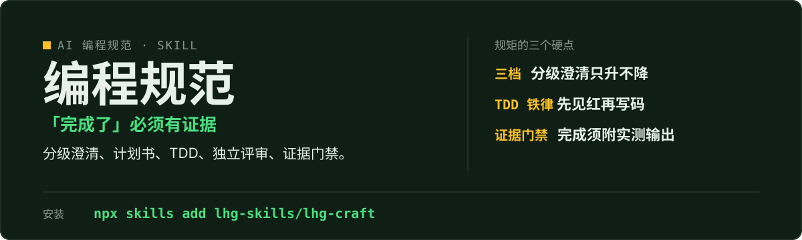

<p align="center">
  
</p>

# lhg-craft · AI 编程工程规范

给 AI 编程立规矩：分级澄清、计划书、TDD、独立评审、证据门禁——「完成了」必须有证据。

（SKILL.md v1.1.0）

## 它是什么

- Phase 1 开工前：分级澄清（验证 / 改动 / 大架构三档，档位只升不降）→ 写回确认 → 大架构档输出计划书（过五项自检）。
- Phase 2 写码中：TDD 铁律（先写失败测试亲眼见红）→ 执行记账 → 独立评审（致命 / 重要 / 次要三级，致命阻塞）→ 证据门禁（「完成了」须附本次实测输出）。
- 附录：中文借口自检表、完工清单；系统化调试引用 lhg-debug，不重复造轮子。

## 先试一句

| 你说 | 它给你 |
|---|---|
| 写个功能 / 重构 / 修 bug | 先立规矩再开工：分级澄清 → 计划书 → TDD |
| 给我个开发流程 / TDD 怎么做 | Phase 1 + Phase 2 全套流程，附完工清单 |
| 这活做完了吗 | 证据门禁：没附本次实测输出就不算完成 |

## 安装

```bash
npx skills add lhg-skills/lhg-craft
```

<details>
<summary>发给 Agent 的安装话术（推荐：小白用户直接复制整段发给你的 Agent）</summary>

> 请帮我安装 Skill「lhg-craft」：先从 Gitee 上 lhg-skills 组织下的 lhg-craft 仓库下载；如果 Gitee 无法访问或下载失败，改从 GitHub 上 lhg-skills 组织下的同名仓库下载。按当前 Agent 的规范安装其中的 Skill，优先全局安装，保留完整目录和依赖。请直接执行，完成后验证是否安装成功，告诉我实际使用的来源、安装的版本号以及如何调用；遇到访问或安装限制请说明具体原因。需要输入管理员密码或确认风险时停下来等我。

**怎么算装好了**：Agent 能在已安装的 Skill 里看到 `lhg-craft`，并报出版本号（与仓库 `SKILL.md` 的 `version` 一致）。只是打开了仓库网页不算安装。

</details>


## 它怎么做

1. 分级澄清
2. 写回确认
3. 计划书（大架构档）
4. TDD 写码
5. 执行记账
6. 独立评审
7. 证据门禁
8. 完工清单

方法借鉴 obra/superpowers（MIT）。

## 什么时候用 / 不用

**用它，当你：**

- 让 AI 写功能、重构、修 bug 之前先对齐
- 要计划书、测试、评审、证据一次齐
- 团队要一套统一的 AI 编程纪律

**别用它，当你：**

- 想跳过澄清直接写代码——先立规矩再开工
- 把「完成了」当口头承诺——必须附实测输出
- 系统化调试走 lhg-debug，不在这里重复造轮子

## 目录结构

```
SKILL.md            skill 全文
references/
  smoke-test.md     自检用例
  fixtures/         6 个计划书对照用例
scripts/
  smoke_test.py     冒烟脚本
LICENSE             MIT
manifest.yaml
icon-512.png
```

## 自检与反馈

冒烟：`python3 scripts/smoke_test.py references/fixtures/fixture-plan-good.md`（另有缺分级、缺断言、表述含糊 3 个坏用例，见 [references/smoke-test.md](references/smoke-test.md)；全部用例 2026-09-29 实测通过）。

发现问题请提 issue：[提一个 issue](https://github.com/lhg-skills/lhg-craft/issues/new)（标题以 `[QC] ` 开头，写清你让它做了什么、它实际给了什么）。

---

## 出品：刘洪光

本 skill 由真人出镜 IP「刘洪光」（安徽合肥）出品，归属 [lhg-skills](https://github.com/lhg-skills)。

- GitHub 主页：https://github.com/lhg-skills —— 全部 skill 开源在此，欢迎 star
- 抖音：搜「刘老师讲AI实战」
- 微信：lhgsmsw

觉得有用，欢迎点 ⭐ Star。
